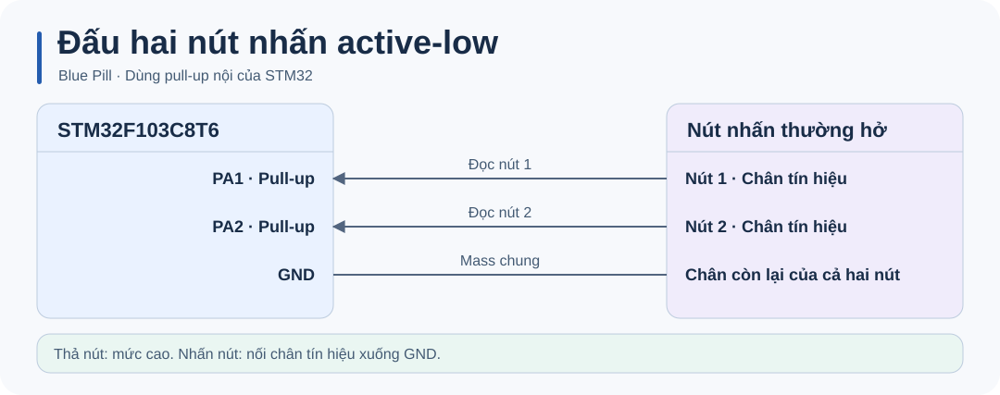

# STM32 Button · Nhận click đơn, click kép và nhấn giữ

## Tổng quan

Thư viện C cho **STM32F1 HAL** nhận sự kiện từ nhiều nút, mỗi nút dùng một handle riêng. Demo Blue Pill dùng hai nút active-low và LED PC13 để hiển thị sự kiện. Chống rung dùng tick và cho phép vòng lặp tiếp tục xử lý nút còn lại.

## Phần cứng



Nối một nút thường hở giữa **PA1 và GND** và nút còn lại giữa **PA2 và GND**. Firmware bật pull-up nội. LED PC13 trên mẫu Blue Pill sáng khi chân ở mức thấp.

## Build và nạp firmware

Cần **Python 3.9+**, **GNU Arm Embedded** (`arm-none-eabi-gcc`, `objcopy`, `size`) và gói **STM32CubeF1 v1.8.7**. Script dùng HAL và startup từ gói ST, cùng linker script 64 KiB flash / 20 KiB SRAM của STM32F103C8.

```sh
python build.py
```

Đặt GNU Arm Embedded vào `PATH`, hoặc chỉ định thư mục `bin` của toolchain. Nếu gói HAL nằm ngoài thư mục mặc định `~/STM32Cube/Repository/STM32Cube_FW_F1_V1.8.7`, truyền đường dẫn tới thư mục chứa `Drivers`.

```sh
python build.py --sdk "<STM32CubeF1 root>" --toolchain "<GNU Arm bin>"
```

Build tạo `build/firmware.elf`, `build/firmware.hex` và `build/firmware.bin`. Nạp `.hex` bằng STM32CubeProgrammer qua ST-LINK/SWD, rồi reset board. Có thể dùng `.elf` để nạp symbol và debug. Firmware mẫu dùng HSE 8 MHz và SYSCLK 72 MHz.

Tài liệu công cụ: [STM32CubeF1](https://github.com/STMicroelectronics/STM32CubeF1) · [STM32CubeProgrammer](https://www.st.com/en/development-tools/stm32cubeprog.html).

## Chạy thử

| Thao tác trên một nút | Kết quả demo |
| --- | --- |
| Một click | Đảo trạng thái LED sau khi hết cửa sổ click kép. |
| Hai click liên tiếp | Tắt LED khi lần nhấn thứ hai được thả. |
| Giữ từ 500 ms | Bật LED, phát một sự kiện mỗi lần giữ. |

Các mảng `single_click_count`, `double_click_count` và `hold_count` giúp xem kết quả riêng của từng nút trong debugger.

## Cấu trúc dự án

| Đường dẫn | Vai trò |
| --- | --- |
| [`Core/Inc/`](Core/Inc/) | Header ứng dụng và thư viện. |
| [`Core/Src/`](Core/Src/) | Demo hai nút và thư viện chống rung. |
| [`firmware/`](firmware/) | Khởi tạo phần cứng, SysTick và linker script. |
| [`docs/`](docs/) | Hướng dẫn kỹ thuật và sơ đồ SVG trong `docs/images/`. |
| [`build.py`](build.py) | Build firmware từ mã nguồn. |
| [`tests/`](tests/) | Kiểm thử logic chạy trên máy tính. |

## Tài liệu

- [Hướng dẫn kỹ thuật](docs/CODE_GUIDE.md).

**Giấy phép**  MIT, theo khai báo của dự án.
