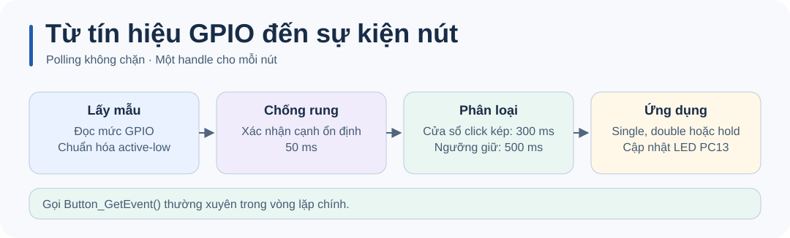

# STM32 Button Library · Click, double click và giữ

Thư viện C cho **STM32F1 HAL** nhận sự kiện từ nhiều nút, mỗi nút dùng một handle riêng. Demo Blue Pill dùng hai nút active-low và LED PC13 để hiển thị sự kiện. Chống rung dùng tick và cho phép vòng lặp tiếp tục xử lý nút còn lại.


## Chạy demo

Nối một nút thường hở giữa **PA1 và GND** và nút còn lại giữa **PA2 và GND**. Firmware bật pull-up nội. LED PC13 trên mẫu Blue Pill sáng khi chân ở mức thấp.

| Thao tác trên một nút | Kết quả demo |
| --- | --- |
| Một click | Đảo trạng thái LED sau khi hết cửa sổ click kép. |
| Hai click liên tiếp | Tắt LED khi lần nhấn thứ hai được thả. |
| Giữ từ 500 ms | Bật LED, phát một sự kiện mỗi lần giữ. |

Các mảng `single_click_count`, `double_click_count` và `hold_count` giúp xem kết quả riêng của từng nút trong debugger.

## Build và nạp firmware

Cần **Python 3.9+**, **GNU Arm Embedded** (`arm-none-eabi-gcc`, `objcopy`, `size`) và gói **STM32CubeF1 v1.8.7**. Script dùng HAL và startup từ gói ST, cùng linker script 64 KiB flash / 20 KiB SRAM của STM32F103C8.

```sh
python build.py
```

Đặt GNU Arm Embedded vào `PATH`, hoặc chỉ định thư mục `bin` của toolchain. Nếu gói HAL nằm ngoài thư mục mặc định `~/STM32Cube/Repository/STM32Cube_FW_F1_V1.8.7`, truyền đường dẫn tới thư mục chứa `Drivers`.

```sh
python build.py --sdk "<STM32CubeF1 root>" --toolchain "<GNU Arm bin>"
```

Build tạo `build/firmware.elf`, `build/firmware.hex` và `build/firmware.bin`. Nạp `.hex` bằng STM32CubeProgrammer qua ST-LINK/SWD, rồi reset board. Có thể dùng `.elf` để nạp symbol và debug. Firmware mẫu dùng HSE 8 MHz và SYSCLK 72 MHz.

Tài liệu công cụ: [STM32CubeF1](https://github.com/STMicroelectronics/STM32CubeF1) · [STM32CubeProgrammer](https://www.st.com/en/development-tools/stm32cubeprog.html).

## Tích hợp thư viện

Thêm [`button_lib.c`](button_lib.c) vào build và đặt [`button_lib.h`](button_lib.h) trong include path. Cấu hình GPIO trước khi gọi `Button_Init()`. Ví dụ active-low:

```c
ButtonHandle_t button;
Button_Init(&button, GPIOA, GPIO_PIN_1, 1);

/* Gọi trong vòng lặp chính. */
ButtonEvent_t event = Button_GetEvent(&button);
```



| API hoặc tham số | Ý nghĩa |
| --- | --- |
| `Button_GetEvent()` | Gọi thường xuyên, chẳng hạn mỗi 5 ms. Trả `BTN_NONE` nếu chưa có sự kiện. |
| `Button_IsPressed()` | Trạng thái nhấn đã qua chống rung, cập nhật bởi lần polling gần nhất. |
| `Button_GetHoldTime()` | Thời gian giữ hiện tại tính bằng ms. Trả 0 sau khi xác nhận thả. |
| `BTN_DEBOUNCE_TIME` | 50 ms để xác nhận một cạnh. |
| `BTN_DOUBLE_CLICK_TIME` | 300 ms từ cạnh thả đầu đến cạnh nhấn thứ hai. |
| `BTN_HOLD_TIME` | 500 ms, tính từ cạnh nhấn đã được xác nhận. |

Xem [ứng dụng mẫu](main_example.c) để dùng hai handle. Nếu nút luôn báo nhấn, kiểm tra cấu hình pull-up và tham số active-low.

## Kiểm thử trên máy tính

Kiểm thử [logic nút nhấn](tests/test_button.c) với GPIO và tick giả lập. Dùng trình biên dịch C11 cho máy tính, chẳng hạn GCC hoặc Clang.

```sh
mkdir -p build
cc -std=c11 -Itests -I. button_lib.c tests/test_button.c -o build/test_button
./build/test_button
```

## Giấy phép

MIT, theo khai báo của dự án.
