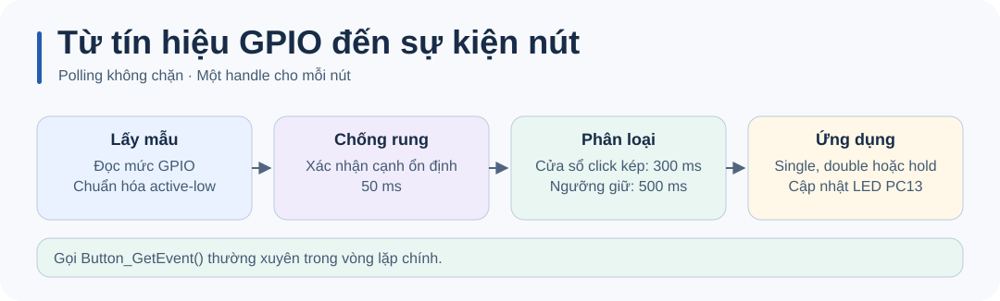

# STM32 Button · Hướng dẫn kỹ thuật

Xem [README](../README.md) để đấu dây, build và chạy thử.

## Cấu hình

Thêm [`button_lib.c`](../Core/Src/button_lib.c) vào build và đặt [`button_lib.h`](../Core/Inc/button_lib.h) trong include path. Cấu hình GPIO trước khi gọi `Button_Init()`. Ví dụ active-low:

```c
ButtonHandle_t button;
Button_Init(&button, GPIOA, GPIO_PIN_1, 1);

/* Gọi trong vòng lặp chính. */
ButtonEvent_t event = Button_GetEvent(&button);
```

## Luồng hoạt động



| API hoặc tham số | Ý nghĩa |
| --- | --- |
| `Button_GetEvent()` | Gọi thường xuyên, chẳng hạn mỗi 5 ms. Trả `BTN_NONE` nếu chưa có sự kiện. |
| `Button_IsPressed()` | Trạng thái nhấn đã qua chống rung, cập nhật bởi lần polling gần nhất. |
| `Button_GetHoldTime()` | Thời gian giữ hiện tại tính bằng ms. Trả 0 sau khi xác nhận thả. |
| `BTN_DEBOUNCE_TIME` | 50 ms để xác nhận một cạnh. |
| `BTN_DOUBLE_CLICK_TIME` | 300 ms từ cạnh thả đầu đến cạnh nhấn thứ hai. |
| `BTN_HOLD_TIME` | 500 ms, tính từ cạnh nhấn đã được xác nhận. |

Xem [ứng dụng mẫu](../Core/Src/main.c) để dùng hai handle. Nếu nút luôn báo nhấn, kiểm tra cấu hình pull-up và tham số active-low.

## Kiểm tra và chẩn đoán

Chạy từ thư mục gốc của repo.

Kiểm thử [logic nút nhấn](../tests/test_button.c) với GPIO và tick giả lập. Dùng trình biên dịch C11 cho máy tính, chẳng hạn GCC hoặc Clang.

```sh
mkdir -p build
cc -std=c11 -Itests -ICore/Inc Core/Src/button_lib.c tests/test_button.c -o build/test_button
./build/test_button
```
